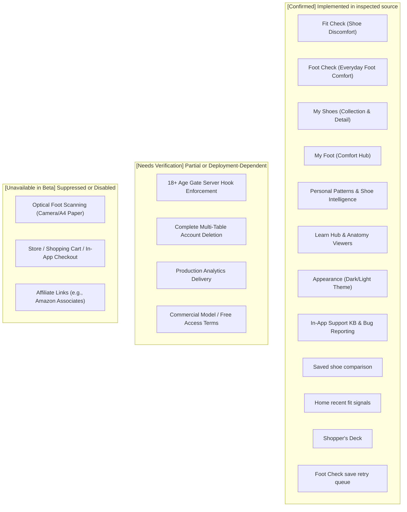

# BadgerFit Website Content Brief & Redesign Guide (First Version)

> **Document:** Website Content Brief & Homepage Launch Plan  
> **Target File:** `WEBCONTENT.MD` (Repository Root)  
> **Status:** Revised Draft for First Website Version (November 2026)  
> **Evidence checked:** November 2026. App and product-document paths refer to the local source checkout at `C:/dev/badger` (HEAD `54e5968`, including local changes). Website links refer to this checkout. Public access, production configuration, and deployed behavior still require verification.
>
> **Governing sources:** `docs/PRD.md`, `docs/SAFETY.md`, `docs/DESIGN.md`, `my-camera-app/src/lib/problemSolver.js`, `my-camera-app/src/lib/footCheckModel.js`, and `my-camera-app/src/lib/badgerChatKb.js`. The app repo’s `website-staged/` policies provide background. Review this checkout’s [Privacy Policy](privacy.html), [Account Deletion](account-deletion.html), and [Terms of Use](terms.html) before publishing.

---

## Executive Overview & Redesign Rules

This brief provides a truthful, simple foundation for the first release of **The Badger Co.** website (`thebadgerco.in`). 

The primary goal of this first website version is to clearly explain the **BadgerFit beta web app**, with the primary focus on **Fit Check** (shoe-specific discomfort) and **Foot Check** (general everyday foot comfort).

### Essential Rules for All Public Website Copy
1. **Focus on the live beta:** Lead with the question-based Fit Check and Foot Check. Explain the invitation-only access described in the current website checkout.
2. **Soften all claims:** Never claim the app "pinpoints causes," "knows why," "fixes shoe pain," or "guarantees fit." Use honest, probabilistic phrasing: *"Your answers suggest this may be contributing,"* *"Consider testing one practical adjustment at a time,"* and *"General comfort guidance based on footwear fit principles."*
3. **No medical claims:** BadgerFit is an educational footwear-fit companion, not a medical device. Never use diagnostic or curative words (*diagnose*, *treatment*, *cure*, *pain relief*, *clinical validation*).
4. **Safety is a boundary, not marketing:** Diabetes, neuropathy, numbness, and other medical flags belong strictly in a cautious safety section. **Do not market BadgerFit to people with diabetes or clinical foot conditions.**
5. **No unverified claims about cost, privacy, or security:** Clearly mark any statements regarding pricing, privacy, security, and legal compliance that cannot be independently confirmed from repository source code alone.
6. **Feature status labels:** Every feature is marked with one of three explicit labels:
   * `[Confirmed]` — implemented and reachable through the inspected source.
   * `[Needs Verification]` — partial, draft, or dependent on unverified live infrastructure.
   * `[Unavailable in Beta]` — disabled in code or deferred to future roadmap; **do not name or promote on the public website.**

---

## 1. What The Badger Co. and BadgerFit Are

### Company Positioning

> **The Badger Co. helps people understand how products fit. We started with shoes.**

The organizing idea is **fit**. Footwear is the first category, BadgerFit is the first product, and designing better-fitting formal shoes is a longer-term ambition. Clothing and accessories are useful analogies for the same problem. The homepage has enough to explain with footwear alone.

### Founder Story for the About Page

I started The Badger Co. with an idea to make formal shoes that feel better during a working day and still look formal. I began with a question about the shoes available in India. How well do they accommodate the different foot shapes of the people who wear them?

I thought about changing shoe sizing. Then I kept coming back to a problem people already face. A pair can be in your usual size and still squeeze your toes, slip at the heel, or press across the top of your foot. It's easy to assume your feet are the problem when the label says the shoe should fit.

**Sometimes the problem is in the product, not the person.**

That's why we started with BadgerFit. It helps people describe what they feel, try a practical adjustment when one is appropriate, and remember what actually changed. We want to make those fit decisions easier today. Over time, we want to design footwear around the fit problems people actually experience.

*Editorial guidance.* Keep the India point framed as the founder's starting question. Save population-wide comparisons of foot shape or claims about industry design practices for research-supported copy. Describe future footwear as an ambition. Use concrete examples of reported observations and recorded outcomes in place of a general "data-driven" claim.

### One-Sentence Description
> **"BadgerFit is an educational footwear-fit companion that helps adults explore why a pair of shoes may feel uncomfortable, test practical everyday adjustments, and build a personal record of what works for their feet."**

### Purpose & Problem Addressed
Shoe discomfort is common, personal, and difficult to interpret:
* A size label gives only part of the fit picture. Width, room over the top of the foot, toe space, and heel shape can affect how a pair feels.
* When shoes slip, pinch, or rub, people typically resort to unguided trial and error—buying random insoles, pulling laces tighter, or assuming shoes simply need a painful "break-in" period.
* Generic fit advice rarely considers whether the shoe has laces, what socks or insoles are being used, when the discomfort starts, or where friction occurs.

BadgerFit addresses this by providing structured, question-based guidance:
* **Explores contributing factors:** Considers shoe category, closure type (laces vs. slip-on), specific discomfort location, and timing to suggest factors that may be contributing to friction or pressure.
* **Suggests practical, reversible adjustments:** Guides users through low-effort changes (such as alternate lacing methods, testing factory footbeds, or adjusting sock thickness) before they spend money on new gear.
* **Screens for red flags:** Asks about warning signs and switches to safety guidance when the answers trigger escalation.
* **Maintains personal fit history:** Allows users to save shoes and checks to keep track of what they have already tested.

*Repository Evidence:* `docs/PRD.md`, `docs/SAFETY.md`, `my-camera-app/src/lib/badgerChatKb.js`.

---

## 2. Who It Is For (Audience Hypotheses)

> [!NOTE]
> **Audience Disclaimer:** The user groups below are **design hypotheses** based on product flows in `docs/PRD.md`. They have not been validated by commercial market research or cohort analytics. They represent common footwear situations, not verified demographic facts.

### Hypothesis 1: Pair-Specific Troubleshooters ("My Shoes Rub or Pinch")
* **Situation:** Adults who wear everyday walking shoes, dress shoes, loafers, or boots that cause localized rubbing, heel slip, or tight toes.
* **Frustrations:** Unsure whether the issue is a normal break-in symptom, an incorrect fastening, or a fundamental mismatch with the shoe's shape.
* **What they may want:** A quick, structured way to see if a simple, reversible adjustment (like re-lacing or sock choice) will help before giving up on the pair.

### Hypothesis 2: Habitual Footwear Modifiers ("Testing Insoles & Pads")
* **Situation:** Wearers who actively experiment with aftermarket insoles, heel grips, or tongue pads.
* **Frustrations:** Adding thick cushioned inserts that crowd the shoe across the instep or toes, accidentally making comfort worse; losing track of what adjustments were tried on which pair.
* **What they may want:** Methodical, step-by-step guidance that tests one change at a time (e.g., verifying fit with the factory footbed first).

### Hypothesis 3: High-Standing Workers & Daily Commuters ("Daily Foot Fatigue")
* **Situation:** Adults who spend long hours on their feet (such as retail, hospitality, healthcare, or daily transit commuters) experiencing generalized foot tiredness or ball-of-foot soreness.
* **Frustrations:** Daily fatigue that builds up across multiple shoes; difficulty telling whether fatigue is from footwear lack of cushioning or daily standing hours.
* **What they may want:** Non-shoe-specific comfort observations (Foot Check) that take daily standing hours into account.

### Hypothesis 4: Footwear Wardrobe Planners ("Tracking Fit Across Pairs")
* **Situation:** Thoughtful shoe buyers who want to avoid repeating the same sizing and shape mistakes when purchasing future footwear.
* **Frustrations:** Inconsistent fit across different brands and models; forgetting why a previous pair felt uncomfortable.
* **What they may want:** A saved shoe collection and fit history to help identify recurring patterns over time.

*(Note: Users with medical conditions such as diabetes are explicitly excluded from marketing personas; see Section 7 for safety handling).*

---

## 3. Feature Inventory & Verification Status

This inventory covers features and operational claims relevant to the launch brief.



### Feature Details

| Feature | Status | What the User Does | What the User Receives | Code Citation |
|:---|:---:|:---|:---|:---|
| **Fit Check** | `[Confirmed]` | Chooses Quick Check or Full Fit Check for a specific pair. | Quick Check asks fewer questions and offers a first step where appropriate. Full Fit Check asks for more context and can show a fuller rationale, cautions, other options, and a more detailed view of the reported areas. | `my-camera-app/src/lib/problemSolver.js`, `ProblemShoeFlow` and `ProblemPlanScreen` in `my-camera-app/src/App.jsx` |
| **Foot Check** | `[Confirmed]` | Reports everyday comfort, time on feet, and relevant context without selecting a pair. | Answer summary, observations, next steps, cautions, and safety guidance. Completed checks can appear in history after a successful save. | `my-camera-app/src/lib/footCheckModel.js` and `Assessment` in `my-camera-app/src/App.jsx` |
| **Collection** | `[Confirmed]` | Adds shoes, runs checks for a saved pair, and records what was tried and what happened. | Pair-specific history, follow-up outcomes, and shoe lifecycle updates such as returned or not worn yet. Shoe details include Storage and Carry Guides when offered. | `my-camera-app/src/SavedShoes.jsx`, `my-camera-app/src/lib/shoeStore.js` |
| **My Foot** | `[Confirmed]` | Navigates to My Foot tab; reviews past Foot Checks and standing load context over time. | Centralized personal foot history and comfort baseline. | `my-camera-app/src/App.jsx` |
| **Insights and Personal Patterns** | `[Confirmed]` | Reviews counts for Fit Checks, Foot Checks, and all saved checks. | A strongest insight when evidence supports one, with separate shoe-fit and foot patterns and frequencies based on their own check histories. A single observation is shown as noticed once. | `FitPreferencesScreen` in `my-camera-app/src/App.jsx`, `my-camera-app/src/lib/fitIntelligence.js` |
| **Learn Hub & Anatomy Viewers** | `[Confirmed]` | Explores interactive shoe anatomy (upper, toe box, outsole, heel) and foot anatomy; reads glossary terms and myth-busting articles. | Plain-language footwear education and contextual definitions linked directly to results. | `my-camera-app/src/BadgerFitLanding.jsx`, `my-camera-app/src/FootAnatomy.jsx` |
| **Theme Switching & In-App Help** | `[Confirmed]` | Switches appearance between Dark, Light, or System; accesses support FAQ and bug reporting. | Instant interface adaptation; direct access to in-app knowledge base. | `my-camera-app/src/ThemeContext.jsx`, `my-camera-app/src/lib/badgerChatKb.js` |
| **Shopper's Deck** | `[Confirmed]` | Opens the shopping brief from Insights when saved check information supports it. | What to look for, what to test, what to avoid, a shopping checklist, and comparison guidance. Users can open Collection to compare saved pairs or start a Fit Check for a pair they are considering. | `ShoppersDeckScreen` in `my-camera-app/src/App.jsx`, `my-camera-app/src/ui/PatternShoppingDeck.jsx` |
| **Home recent fit signals** | `[Confirmed]` | Returns Home after saving a check. | Recent observations from Fit Checks and Foot Checks, labeled by check type. | `my-camera-app/src/ui/HomeRecord.jsx` |
| **Shoe Comparison** | `[Confirmed]` | Selects two saved pairs from Collection. | A side-by-side view of pair-specific Fit Check evidence, with an explicit state when information is insufficient. | `my-camera-app/src/SavedShoes.jsx`, `my-camera-app/src/ui/ShoeComparison.jsx` |
| **Foot Check Save Retry Queue** | `[Confirmed]` | Completes a check while signed in. | When browser storage is available, the app can queue a save locally and retry it after reopening the app or reconnecting. Verify production sync before making public offline claims. | `my-camera-app/src/lib/pendingFootCheckSync.js`, `retryPendingFootCheckSaves` in `my-camera-app/src/App.jsx` |
| **Production Analytics Delivery** | `[Needs Verification]` | Uses the app. | Verify deployed event payloads and destinations before making analytics claims. | `my-camera-app/src/analytics/trackEvent.js`, `my-camera-app/src/lib/privateTelemetry.js` |
| **18+ Age Gate Server Enforcement** | `[Needs Verification]` | Confirms adult eligibility (18+) on registration. | Frontend UI gate and SQL exist, but live production Supabase Auth hook enforcement is unverified by repo alone. | `docs/PRD.md`, `my-camera-app/src/lib/ageGate.js` |
| **Full Account Deletion Coverage** | `[Needs Verification]` | Requests deletion in Profile → Manage Data (types `DELETE`). | Backend endpoint and SQL exist, but live production multi-table purge verification remains required. | `my-camera-app/src/ui/ManageDataScreen.jsx`, `docs/PRD.md` |
| **Commercial Terms** | `[Needs Verification]` | Reviews beta access terms. | Access and pricing terms require owner confirmation. | `BETA_COMMERCE_ENABLED` in `my-camera-app/src/App.jsx` establishes the feature flag only. |
| **Camera Foot Scanning** | `[Unavailable in Beta]` | Production builds disable the optical scan entry points. | A development-only flag can enable testing outside production. | `SCAN_TESTING_ENABLED` in `my-camera-app/src/App.jsx`, `docs/SAFETY.md` |
| **Store & Checkout** | `[Unavailable in Beta]` | Beta commerce is disabled in source. | Checkout and purchase controls are gated off. | `BETA_COMMERCE_ENABLED` in `my-camera-app/src/App.jsx`, `my-camera-app/src/betaCopyTruthfulness.test.js` |
| **Affiliate Purchase Links** | `[Unavailable in Beta]` | Affiliate purchase links are omitted in the beta UI. | Revenue and commercial relationships require separate business verification. | `my-camera-app/src/betaCopyTruthfulness.test.js`, `docs/SAFETY.md` |

---

## 4. How It Works (Accurate User Journeys)

### Journey 1: Fit Check (Shoe Discomfort)
1. **Mode and shoe details:** Quick Check asks fewer questions to offer a practical first step. Full Fit Check asks for more context and gives a fuller explanation where useful. The user can select a saved pair or enter details for the pair they are checking. The app asks for the shoe category (Sneaker, Walking, Formal, Boot, Other). For formal shoes, it asks for the subtype (Loafer, Derby, Oxford) and confirms whether it has laces or is a slip-on. *(Shoes without laces are never shown lacing advice).*
2. **Problem Area (Where`):** The user selects up to 3 areas: Heel, Toes/Forefoot, Top of foot, Arch, Ball of foot, or Whole shoe.
3. **Specific Friction (What`):**
   * *Heel:* e.g., "It lifts or slips out as I walk" or "It rubs or catches at the back."
   * *Toes:* e.g., "Squeezed or cramped across the toes" or "Rubbing on the outer edge or little toe."
   * *Top of foot:* "Pressure or tightness" or "Numbness or tingling."
4. **Safety Check:** Asks about severe pain regardless of the shoe, numbness that persists with the shoe off, persistent swelling, broken skin, or trouble walking. Heel and forefoot paths also ask about bleeding and signs of infection. Users must select "None of these" or the applicable flag.
5. **Context Questions:** Timing (immediately, within 30 min, after a few hours, end of day), socks worn (thin, thick), and insole type (factory, added insole).
6. **Result Hierarchy:**
   * **If a red flag is reported:** Routine fit advice is suppressed. The result directs the user to pause wear and seek qualified advice.
   * **When routine guidance is appropriate:** Quick Check focuses on the first step and offers a way to continue into Full Fit Check. The full result can include the following.
     * **Try First:** One practical, reversible adjustment (e.g., *"Try heel-lock lacing using the top eyelets to secure your heel without over-tightening the rest of the shoe"* or *"Try thinner socks and see whether the pressure changes"*).
     * **Rationale:** An explanation such as “Why this first” connects the suggestion to reported answers where available.
     * **Cautions:** The result can show “Don’t do this yet” (e.g., *"Avoid tightening the laces further to hold the foot back — that usually adds pressure across the instep"*).
     * **Other Things You Can Try:** Secondary suggestions (e.g., trying a shoe with a rounder toe box).
     * **Fit Discomfort Map:** Visual reference showing the areas the user selected.
7. **Save & Follow-up:** The user saves the check to their shoe history and can later record an outcome (whether the adjustment helped).

*Evidence:* `my-camera-app/src/lib/problemSolver.js`, `my-camera-app/src/App.jsx`.

---

**Two examples.** At a meeting, heel rubbing in one dress shoe is a Quick Check example. Discomfort that shows up across several pairs or when out of shoes is a Foot Check example. While trying on a new pair, use a check or the shopping checklist to think through what you notice. A short try-on gives limited evidence about a full day of wear.

### Journey 2: Foot Check (Everyday Foot Comfort)
1. **Entry:** User starts Foot Check (no shoe required).
2. **Discomfort Zones:** Taps zones on an interactive foot graphic: Toes, Ball of foot, Arch (inner midfoot), Outer midfoot, Heel, Top/instep, or selects no specific discomfort.
3. **Daily Standing Hours:** Selects daily time on feet (<2h, 2–6h, 6–8h, 8+ hours).
4. **Health & Sensitivity Context:** Reports diabetes or foot sensation status.
5. **Safety Check:** Confirms whether red-flag symptoms are present.
6. **Insole Experience:** Notes whether past insoles helped, made no difference, made discomfort worse, or unsure. *(If an insole made discomfort worse, the app advises testing with the factory footbed only to see whether extra insert volume may be contributing).*
7. **The result overview:**
   * **Your answers:** Summary of reported areas, standing hours, and context.
   * **What We Noticed:** Summary of load factors (e.g., cumulative load from 8+ hours on daily surfaces).
   * **Try First:** General footwear comfort practices (e.g., checking that the widest part of the foot aligns with the shoe).
   * **What to Avoid:** Clear cautions (e.g., avoiding rigid arch supports that create sharp pressure points).
   * **Safety Guidance:** Explicit non-medical reminder and clinical escalation instructions.

*Evidence:* `my-camera-app/src/lib/footCheckModel.js`, `my-camera-app/src/App.jsx`.

---

## 5. Homepage-First Launch Plan & Concise Copy

Use `index.html` as the first public landing page for the two checks. Keep the existing Privacy Policy, Account Deletion, Terms of Use, and beta access pages available at their current URLs.

| Homepage item | Destination |
|---|---|
| Fit Check | `#fit-check` |
| Foot Check | `#foot-check` |
| How it works | `#how-it-works` |
| Safety | `#safety` |
| FAQ | `#faq` |
| Learn about beta access | [Beta access](waitlist.html) |
| Sign in for invited testers | The app address listed on the [Account Deletion page](account-deletion.html). Confirm the destination and access process before adding a direct link. |
| Footer | [Privacy Policy](privacy.html), [Account Deletion](account-deletion.html), [Terms of Use](terms.html) |

### Proposed Homepage Copy (`index.html`)

```text
[NAVIGATION]
The Badger Co.
Fit Check · Foot Check · How it works · Safety · FAQ
Learn about beta access

[HERO]
BadgerFit · Invite-only beta
Practical footwear guidance. One adjustment at a time.
A pair can be your usual size and still feel wrong. BadgerFit, the first product from The Badger Co., helps you explore how your shoes fit, try a practical adjustment, and keep track of what changes.
Learn about beta access
See how it works

[THE PROBLEM]
Sometimes the problem is in the product, not the person.
Your usual size can still leave too little room at the toes, let your heel slip, or press across the top of your foot. Start with where you feel it and when it happens.

[FIT CHECK]
Explore the fit of a specific pair.
If a shoe rubs, pinches, or presses, choose Quick Check for a practical first step. Full Fit Check asks more questions and can explain what may be contributing, what to try, and what to avoid.

[FOOT CHECK]
Review your everyday foot comfort.
If discomfort comes up across different pairs or when you’re out of shoes, start with Foot Check. Share where you notice it and how long you spend on your feet. You’ll get general comfort guidance and footwear features to consider.

[HOW IT WORKS]
1. Choose Fit Check for a specific pair or Foot Check for everyday comfort.
2. Answer questions about what you notice, where you feel it, and any relevant context.
3. Review your next step. When an adjustment is suggested, try one change at a time so you can tell what felt different.

[YOUR FIT RECORD]
Remember what worked for each pair.
Save shoes in Collection, record what you tried, and compare two saved pairs using their own Fit Check histories. As you build up your record, Insights shows what you have reported more than once. Shopper's Deck can turn saved check information into a checklist for your next try-on.

[SAFETY]
BadgerFit is for footwear education. For severe or lasting discomfort, lingering numbness, swelling that persists, or open skin, pause and seek advice from a qualified healthcare professional. If you have diabetes or reduced foot sensation, seek qualified advice before trying footwear inserts or adjustments.

[FAQ]
Which check should I start with?
Choose Fit Check when one pair is the focus. Choose Foot Check when you want to reflect on everyday comfort across different shoes or out of shoes.

What do I need to do a check?
Your observations and answers about how your shoes or feet feel. For Fit Check, have a specific pair in mind.

How do I access the beta?
BadgerFit is currently available by invitation. See the beta access page for updates.

Where can I learn about my data or request account deletion?
See the Privacy Policy for data handling. The Account Deletion page explains how to request deletion in the app or by email.

[FOOTER]
The Badger Co. · Kanpur, Uttar Pradesh, India
support@thebadgerco.in
Privacy Policy · Account Deletion · Terms of Use
BadgerFit provides educational footwear guidance for adults aged 18 and older.
```

---

## 6. Visual Suggestions & Screen Recommendations

To explain BadgerFit honestly on the marketing website, use authentic UI elements from the application rather than generic lifestyle footwear stock imagery.

| Priority | Recommended App Screen | Repository Source | Why It Explains the Product |
|:---:|:---|:---|:---|
| **1** | **Fit Check: Discomfort Selection (“Where does this shoe feel uncomfortable?”)** | `my-camera-app/src/App.jsx` | Shows how to select familiar areas such as the heel, toes, top of foot, or arch. |
| **2** | **Fit Check: Result Plan Screen** | `my-camera-app/src/App.jsx` | Shows a suggested first step, the reasoning behind it, and a caution when applicable. |
| **3** | **Interactive Shoe Anatomy Viewer** | `my-camera-app/src/BadgerFitLanding.jsx`, `my-camera-app/public/images/home/shoe-anatomy-v1.jpg` | Gives readers a visual reference for footwear parts such as the upper, toe box, and outsole. |
| **4** | **Foot Check: 5-Card Overview** | `my-camera-app/src/App.jsx` | Shows how the overview organizes answers, observations, suggested next steps, cautions, and safety guidance. |
| **5** | **Collection / My Shoes Rack** | `my-camera-app/src/SavedShoes.jsx` | Shows how users save their everyday shoes, dress shoes, and sneakers to track fit notes over time. |

### Evaluation of the First Question Screens
* **Shoe Type & Fastening Selection (Step 1):** **Recommended.** Showing the screen where users select shoe type (Formal, Loafer, Sneaker, Boot) and fastening (laces vs. slip-on) immediately communicates that recommendations are tailored to shoe construction (e.g., loafers do not receive lacing advice).
* **Area Selection (Step 2):** **Highly Recommended.** Highlights how fast and simple it is to point to friction areas.
* **Safety Screening Screen:** Use only within the safety section if a capture helps explain the questions. Use illustrative answers and keep personal data out of captures.

---

## 7. Safety, Red Flags & Boundaries (Non-Marketing Section)

> [!IMPORTANT]
> **Strict Regulatory & Ethical Boundary:** The safety guidelines below must **never** be framed as marketing features or used to target clinical cohorts. They exist strictly as conservative safeguards to protect users.

### 1. Handling Diabetes & Reduced Foot Sensation
* **Why the app asks:** The answers can change which suggestions the app presents.
* **What the app does when diabetes/reduced sensation is reported:**
  * Routine suggestions for over-the-counter toe spacers, pads, or rigid inserts are **suppressed** (`my-camera-app/src/lib/footCheckModel.js`).
  * The user is shown explicit advice to inspect their feet daily for redness, pressure marks, or skin changes.
  * The app explicitly directs the user to consult a healthcare professional or podiatrist before using footwear inserts.
* **Website Marketing Rule:** **Never market BadgerFit to individuals with diabetes.** Never claim that BadgerFit provides "diabetic shoe fitting" or "diabetic foot protection." Keep diabetes mentions strictly inside the safety boundary copy.

### 2. Red-Flag Symptoms & Recommendation Suppression
The app screens for clinical red flags across both Fit Check and Foot Check:
* Pain severe enough to stop walking regardless of the shoe.
* Numbness or tingling that does not resolve after the shoe is removed.
* Swelling that persists after resting, or swelling localized to only one foot.
* Open or broken skin. Heel and forefoot Fit Check paths also ask about bleeding and signs of infection.
* Inability to walk normally even with shoes off.

**When the answers trigger escalation:**
* Routine fit experimentation is completely **suppressed** (`plan.escalated = true`, `plan.stopWear = true`).
* The user sees safety guidance that directs them to pause and seek qualified advice. (`my-camera-app/src/lib/problemSolver.js`, `docs/SAFETY.md`).

### 3. Claims Integrity & Phrasing Standards
* **Do not use:** *diagnose*, *treatment*, *cure*, *prevent*, *injury prevention*, *pain relief*, *orthopedic fix*, *clinically proven*, or *guaranteed fit*.
* **Preferred phrasing:** *"Your answers suggest this may be contributing,"* *"Consider testing one change at a time,"* *"General footwear comfort guidance,"* and *"Stop wearing the shoe and seek qualified professional advice if discomfort persists."*

### 4. Privacy, Security & Legal Claims Requiring Operational Verification
Before publishing claims regarding privacy, security, and data handling on the live website, the following items must be verified:
* `[Needs Verification]` **Adult Age Eligibility (18+):** The frontend gate and SQL exist, but live production Supabase Auth hook enforcement must be operationally verified.
* `[Needs Verification]` **Account Deletion Completeness:** While in-app self-service deletion is implemented in code (`my-camera-app/src/ui/ManageDataScreen.jsx`), live end-to-end purge across all Supabase production tables requires operational confirmation before claiming complete data eradication.
* `[Needs Verification]` **Privacy and hosting:** Review the [Privacy Policy](privacy.html) and [Account Deletion page](account-deletion.html) against production data handling, service providers, and retention. Legal compliance requires owner review.
* `[Needs Verification]` **Analytics:** Verify live configuration and what reaches each destination before promising analytics isolation or data minimization.
* `[Needs Verification]` **Beta access and cost:** Confirm the current invitation and sign-in route. Pricing and commercial neutrality claims require owner confirmation.

---

## 8. Open Questions & Stakeholder Decisions

1. **Brand and audience.** The draft uses The Badger Co. as the site brand and BadgerFit as the product. Confirm whether the homepage should explicitly address men, as the current [BadgerFit page](badgerfit.html) does, or use broader audience wording.
2. **Beta access.** Direct the primary public CTA to the [beta access page](waitlist.html) under the current invitation-only messaging. Confirm whether invited testers should also get a direct sign-in link. The [BadgerFit page](badgerfit.html) already has a Fit Check preview.
3. **Footwear scope.** Decide whether to name everyday shoes, loafers, dress shoes, and boots on the homepage. Verify the final examples against `my-camera-app/src/lib/badgerChatKb.js`.
4. **Future features.** Keep roadmap decisions internal for the first release.
5. **Publishing.** Confirm the Hostinger publishing procedure and which files are served on `thebadgerco.in`. Before switching the homepage, verify the app access route, homepage anchors, and footer links in staging.

---

*End of Revised Content Brief (`WEBCONTENT.MD`)*
